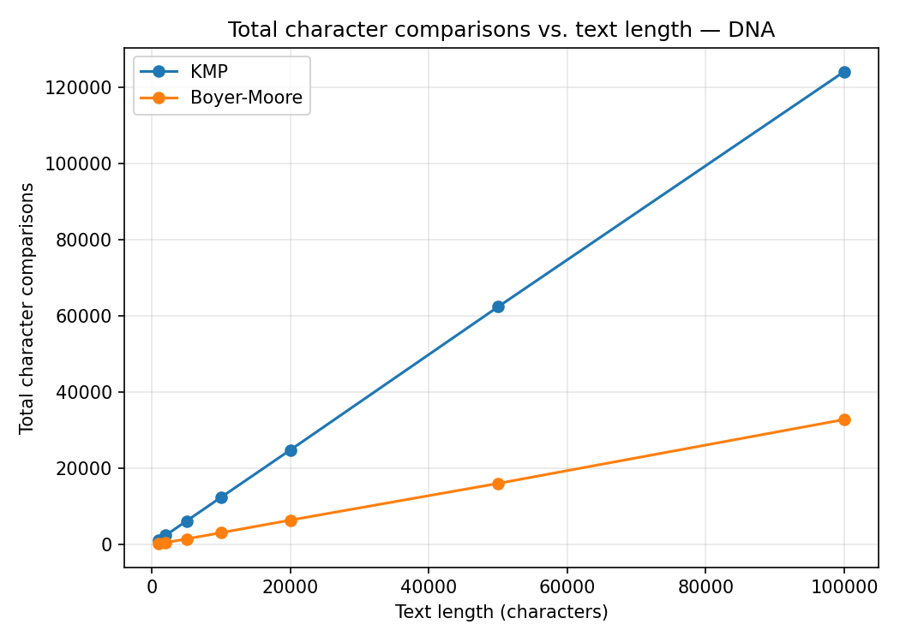
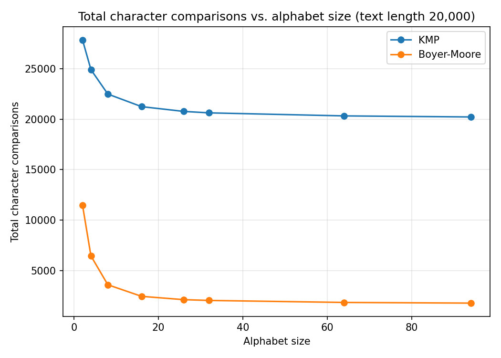

# KMP vs. Boyer-Moore: String Matching & Text Processing

Implementation and empirical analysis of two linear-time substring-search
algorithms:

- **Knuth-Morris-Pratt (KMP)** — preprocesses the pattern into a *Longest
  Prefix-Suffix* (LPS) / failure array, then scans the text once, never
  re-reading a text character after a mismatch.
- **Boyer-Moore (BM)** — preprocesses the pattern into a *bad-character*
  table and a *strong good-suffix* table, then scans the text right-to-left
  within each alignment, often skipping multiple characters per shift.

Both implementations return every match (including overlapping ones) and are
instrumented to count character comparisons and time preprocessing /
matching phases separately.

## Project layout

```
string_matching/
  kmp.py              KMP: compute_lps() + kmp_search()
  boyer_moore.py       Boyer-Moore: bad-char + good-suffix tables + boyer_moore_search()
  text_generator.py    DNA / pseudo-English / uniform-alphabet text generators
  demo.py              Small worked example (textbook pattern) printing diagnostics
  benchmark.py         Full experiment suite -> results/*.csv and results/*.png
  tests/
    test_algorithms.py Correctness tests (vs. str.find) incl. edge cases
  results/             Generated CSVs and plots (created by benchmark.py)
```

## Running it

```powershell
pip install -r requirements.txt
python -m unittest tests.test_algorithms -v   # correctness
python demo.py                                # quick worked example
python benchmark.py                           # full analysis -> results/
```

## Experimental setup

Three experiments, each averaging `REPEATS = 5` random `(text, pattern)`
draws per data point (pattern = a genuine substring of the text, so a match
is always found):

1. **Text length sweep** — pattern length fixed at 12, text length in
   `{1k, 2k, 5k, 10k, 20k, 50k, 100k}` chars, for:
   - **DNA**: alphabet `{A,C,G,T}` (size 4), uniform random.
   - **English prose**: 27-symbol alphabet (26 letters + space) sampled
     using approximate English letter frequencies (pseudo-English, since no
     external corpus is bundled).
2. **Alphabet size sweep** — text length fixed at 20,000, pattern length 12,
   synthetic uniform-random text over alphabets of size
   `{2, 4, 8, 16, 26, 32, 64, 94}`.
3. **Worst-case vs. average-case** — binary alphabet, text length 20,000,
   comparing a random (average-case) pattern against the classic
   `"aaa...ab"` adversarial pattern.

## Results

### Comparisons vs. text length (DNA, alphabet size 4)



### Comparisons vs. alphabet size (text length 20,000)



(Full plots for English prose and timing are in `../benchmark-data/`: `comparisons_vs_length_English.png`,
`time_vs_length_DNA.png`, `time_vs_length_English.png`, `time_vs_alphabet_size.png`.)

Running `python benchmark.py` from this folder regenerates these into a local `results/` directory.

## Analysis / findings

- **Preprocessing time.** Both are O(m) in the pattern length, so for a
  fixed pattern length (12) preprocessing cost is small and roughly
  constant as text length grows. Boyer-Moore's good-suffix table
  construction does more bookkeeping (two passes, border array) than KMP's
  single-pass LPS, so BM's preprocessing time per run is consistently
  somewhat higher, but it is dwarfed by matching time once the text is more
  than a few hundred characters.

- **Matching-time growth (text length sweep).** Both algorithms scale
  linearly with text length as expected (straight lines in the plots), but
  the **slope differs sharply**: on the 4-symbol DNA alphabet, KMP performs
  roughly **1.24 comparisons per text character** (it is guaranteed
  `<= 2n` comparisons), while Boyer-Moore performs roughly **0.33
  comparisons per text character** here — about 3.7x fewer total
  comparisons at 100,000 characters. This matches the theoretical
  expectation that BM's expected-case behavior is sub-linear in the number
  of text characters actually inspected (it skips characters with the
  bad-character/good-suffix shifts).

- **Effect of alphabet size.** The alphabet-size sweep shows BM's advantage
  grows, then saturates, as the alphabet gets larger: with a binary alphabet
  (size 2) both algorithms must examine most characters (few bad-character
  skips are possible because any character is likely to reoccur nearby), so
  BM's benefit over KMP is modest. As alphabet size increases toward the
  mid-20s–30s (English-like) and beyond, the probability that a text
  character also appears late in the pattern drops sharply, so bad-character
  shifts become large and BM's comparison count drops steeply before
  flattening out for alphabets beyond ~30 symbols (diminishing returns —
  shifts are already close to the maximum possible). KMP is comparison-wise
  almost flat with alphabet size (its guarantee is really about pattern
  self-similarity, not alphabet size), with only a small drop because
  fewer incidental partial matches occur with larger alphabets.

  Practical implication: **DNA sequences (alphabet size 4) are the worst
  case for Boyer-Moore's skip heuristics** among the scenarios tested —
  repeated nucleotides mean more partial matches and smaller shifts — while
  **English prose (alphabet size ~27)** already gives BM a large advantage,
  and purely synthetic large alphabets (size 64–94, e.g., binary/genomic
  encodings with byte-level symbols) give the best case for BM.

- **Binary-pattern comparison.** KMP's comparison count is nearly identical
  between the random pattern and the tested repeated-prefix pattern, which is
  consistent with KMP's `O(n + m)` overall guarantee. Boyer-Moore's count can
  decrease on the tested `"aaa...ab"` pattern because its final character
  often enables a useful bad-character shift against the generated random
  binary text. This is an illustrative input comparison, not a constructed
  worst case. The standard Boyer-Moore algorithm with bad-character and
  good-suffix rules but without Galil's optimization can have `O(nm)` worst-
  case search time; this implementation does not claim a linear worst-case
  bound.

- **Bottom line.** In these generated inputs, Boyer-Moore makes fewer
  matching comparisons than KMP, particularly for English-like text. The
  benchmark is limited to the chosen alphabet, text lengths, pattern length,
  and random seeds; it does not establish that Boyer-Moore is always faster.
  KMP has a simpler linear worst-case matching guarantee, while this
  Boyer-Moore implementation often skips more text positions on typical
  inputs but has an `O(nm)` general worst-case bound.

## Complexity summary

| Algorithm    | Preprocessing | Worst-case matching | Typical matching (large alphabet) |
|--------------|---------------|----------------------|------------------------------------|
| KMP          | O(m)          | O(n)                 | O(n)                               |
| Boyer-Moore  | O(m) for these table constructions | O(nm) without Galil optimization | Often sub-linear character inspections; O(n/m) best case for fixed m |

where `n` = text length, `m` = pattern length, `σ` = alphabet size.
